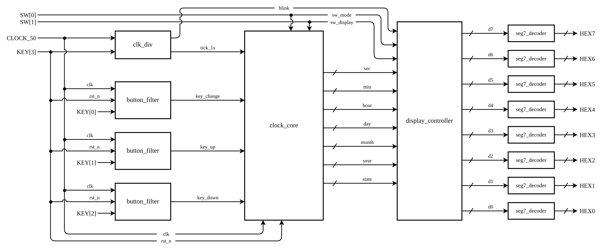

# ĐỒNG HỒ THẾ KỶ TRÊN FPGA DE2-115

**Nền tảng:** Altera DE2-115 (Cyclone IV E – EP4CE115F29C7)
**Ngôn ngữ:** Verilog HDL | **Clock:** 50 MHz đồng bộ duy nhất | **Tổng dòng code:** ~510 dòng (6 module RTL + 1 Testbench)

---

## 1. Tổng Quan Hệ Thống

### 1.1. Chức Năng

| Tính năng | Mô tả |
| :--- | :--- |
| Đếm thời gian | Giây → Phút → Giờ → Ngày → Tháng → Năm (tự động nối tiếp) |
| Phạm vi năm | 2000 – 2099 (1 thế kỷ, quay vòng) |
| Năm nhuận | Tối ưu phần cứng 2000–2099: `year[1:0] == 2'b00` (không tốn bộ chia) |
| Chỉnh giờ/ngày | Tăng/giảm quay vòng, tự động kẹp ngày hợp lệ khi đổi tháng |
| Hiển thị | 8 LED 7 đoạn: chế độ Giờ (`HH:MM:SS`) hoặc Ngày (`DD:MM:YYYY`) |
| Nhấp nháy | Trường đang chỉnh nhấp nháy 2 Hz trong chế độ cài đặt |

### 1.2. Sơ Đồ Khối (Block Diagram)



---

## 2. Giao Diện Phần Cứng

### 2.1. Bảng Gán Chân (Pin Assignment)

| Tín hiệu | Hướng | Chân DE2-115 | Chức năng |
| :--- | :---: | :--- | :--- |
| `CLOCK_50` | IN | PIN_Y2 | Xung nhịp hệ thống 50 MHz |
| `KEY[3]` | IN | PIN_R24 | Reset (Active-Low: bấm = reset) |
| `KEY[0]` | IN | PIN_M23 | Chuyển trường cần chỉnh |
| `KEY[1]` | IN | PIN_M21 | Tăng giá trị (+1) |
| `KEY[2]` | IN | PIN_N21 | Giảm giá trị (-1) |
| `SW[0]` | IN | PIN_AB28 | `0` = Chạy (RUN) / `1` = Cài đặt (SET) |
| `SW[1]` | IN | PIN_AC28 | `0` = Xem Giờ / `1` = Xem Ngày |
| `HEX7..HEX0` | OUT | *Xem file QSF* | 8 LED 7 đoạn (Active-Low) |

> File gán chân đầy đủ: [`syn/de2_115_pins.qsf`](syn/de2_115_pins.qsf)

### 2.2. Ánh Xạ LED 7 Đoạn

**Chế độ Giờ** (`SW[1] = 0`):
```
  HEX7  HEX6    HEX5  HEX4    HEX3  HEX2    HEX1  HEX0
┌─────┬─────┐ ┌─────┬─────┐ ┌─────┬─────┐ ┌─────┬─────┐
│  H  │  H  │ │  M  │  M  │ │  S  │  S  │ │ OFF │ OFF │
│(x10)│(x1) │ │(x10)│(x1) │ │(x10)│(x1) │ │     │     │
└─────┴─────┘ └─────┴─────┘ └─────┴─────┘ └─────┴─────┘
```

**Chế độ Ngày** (`SW[1] = 1`):
```
  HEX7  HEX6    HEX5  HEX4    HEX3  HEX2  HEX1  HEX0
┌─────┬─────┐ ┌─────┬─────┐ ┌─────┬─────┬─────┬─────┐
│  D  │  D  │ │  M  │  M  │ │  Y  │  Y  │  Y  │  Y  │
│(x10)│(x1) │ │(x10)│(x1) │ │(x1k)│(x100│(x10)│(x1) │
└─────┴─────┘ └─────┴─────┘ └─────┴─────┴─────┴─────┘
```

---

## 3. Kiến Trúc Module

### 3.1. Cây Module (Hierarchy)

```
century_clock_top
├── clk_div               Bộ chia tần → tick_1s, blink
├── button_filter (x3)    Lọc rung → key_change, key_up, key_down
├── clock_core            FSM + RTC + Lịch thế kỷ
├── display_controller    Chọn hiển thị + Nhấp nháy
└── seg7_decoder (x8)     Giải mã BCD → LED 7 đoạn
```

### 3.2. Chi Tiết Từng Module

| Module | File | Dòng | Chức năng chính |
| :--- | :--- | :---: | :--- |
| `clk_div` | [`rtl/clk_div.v`](rtl/clk_div.v) | 41 | Đếm 50M xung → xung `tick_1s` (1 chu kỳ clock/giây) và `blink` (2 Hz) |
| `button_filter` | [`rtl/button_filter.v`](rtl/button_filter.v) | 53 | Đồng bộ 2-FF → Đảo Active-Low → Lọc rung 20ms → Xuất xung 1 chu kỳ |
| `clock_core` | [`rtl/clock_core.v`](rtl/clock_core.v) | 145 | FSM 7 trạng thái + Bộ đếm RTC + Năm nhuận + Kẹp ngày tự động |
| `display_controller` | [`rtl/display_controller.v`](rtl/display_controller.v) | 75 | Tách BCD (`val/10`, `val%10`) + MUX Giờ/Ngày + Blanking khi SET |
| `seg7_decoder` | [`rtl/seg7_decoder.v`](rtl/seg7_decoder.v) | 20 | Bảng chân lý BCD → 7 đoạn Active-Low; `4'hF` = tắt |
| `century_clock_top` | [`rtl/century_clock_top.v`](rtl/century_clock_top.v) | 75 | Kết nối toàn bộ hệ thống với chân I/O DE2-115 |

---

## 4. Chi Tiết Thiết Kế

### 4.1. Miền Xung Nhịp (Clock Domain)

Toàn bộ hệ thống sử dụng **duy nhất 1 clock domain** (`CLOCK_50` = 50 MHz). Không sử dụng generated clock hay gated clock. Xung 1 giây và 2 Hz được tạo dưới dạng **Clock Enable (tick pulse)** rộng đúng 1 chu kỳ.

```
CLOCK_50  ─────┬──────┬──────┬──────────────────────┐
               │      │      │                       │
            clk_div  btn0  btn1  btn2   clock_core  display
               │                           │
            tick_1s ───────────────────────→│
            blink   ─────────────────────────────────→display
```

### 4.2. Máy Trạng Thái Hữu Hạn (FSM)

```
                        SW[0] = 0 (RUN)
                    ┌────────────────────┐
                    │                    │
                    ▼                    │
               ┌─────────┐              │
               │  S_RUN  │──────────────┘
               └────┬────┘
          SW[0]=1   │
         ┌──────────┴──────────┐
    SW[1]=0                 SW[1]=1
         │                     │
         ▼                     ▼
    ┌──────────┐         ┌──────────┐
 ┌→ │ SET_HOUR │         │ SET_DAY  │ ←┐
 │  └────┬─────┘         └────┬─────┘  │
 │  KEY0 │                KEY0 │       │
 │       ▼                     ▼       │
 │  ┌──────────┐         ┌──────────┐  │
 │  │ SET_MIN  │         │SET_MONTH │  │
 │  └────┬─────┘         └────┬─────┘  │
 │  KEY0 │                KEY0 │       │
 │       ▼                     ▼       │
 │  ┌──────────┐         ┌──────────┐  │
 │  │ SET_SEC  │         │ SET_YEAR │  │
 │  └────┬─────┘         └────┬─────┘  │
 │  KEY0 │                KEY0 │       │
 └───────┘                     └───────┘
```

| Trạng thái | Mã | Mô tả |
| :--- | :---: | :--- |
| `S_RUN` | `3'd0` | Đồng hồ chạy bình thường, đếm tự động |
| `S_SET_HOUR` | `3'd1` | Chỉnh giờ (0–23) |
| `S_SET_MIN` | `3'd2` | Chỉnh phút (0–59) |
| `S_SET_SEC` | `3'd3` | Chỉnh giây (0–59) |
| `S_SET_DAY` | `3'd4` | Chỉnh ngày (1–max_day) |
| `S_SET_MONTH` | `3'd5` | Chỉnh tháng (1–12) |
| `S_SET_YEAR` | `3'd6` | Chỉnh năm (2000–2099) |

### 4.3. Chuỗi Đếm Thời Gian (RTC Chain)

Khi `tick_1s = 1`:

```
sec++ ──(sec==59)──→ min++ ──(min==59)──→ hour++ ──(hour==23)──→ day++
                                                                   │
                                                           (day≥max_day)
                                                                   │
                                                                   ▼
                                                         month++ ──(month==12)──→ year++
```

### 4.4. Thuật Toán Năm Nhuận (Leap Year)

Trong phạm vi 1 thế kỷ (2000 – 2099):
- Năm 2000 chia hết cho 400 nên là năm nhuận.
- Các năm từ 2001 đến 2099 không có năm nào tròn 100 (năm tròn 100 kế tiếp là 2100).
- Do đó, mọi năm chia hết cho 4 trong thế kỷ này đều là năm nhuận 100%.

```verilog
// Tối ưu hóa: chỉ cần kiểm tra 2 bit LSB, loại bỏ hoàn toàn bộ chia modulo (tiết kiệm ~120 LEs)
wire is_leap = (year[1:0] == 2'b00);
```

| Năm | `year[1:0] == 2'b00` | Kết quả | Ghi chú |
| :---: | :---: | :---: | :--- |
| 2000 | `2'b00` (✓) | **Nhuận** ✓ | Năm thế kỷ chia hết cho 400 |
| 2024 | `2'b00` (✓) | **Nhuận** ✓ | Chia hết cho 4 |
| 2025 | `2'b01` (✗) | Không nhuận ✗ | Năm lẻ |
| 2096 | `2'b00` (✓) | **Nhuận** ✓ | Chia hết cho 4 |

### 4.5. Bảng Số Ngày Tối Đa Trong Tháng

| Tháng | `max_day` |
| :--- | :---: |
| 1, 3, 5, 7, 8, 10, 12 | **31** |
| 4, 6, 9, 11 | **30** |
| 2 (năm nhuận) | **29** |
| 2 (năm thường) | **28** |

**Cơ chế kẹp ngày (Auto-Clamp):** Nếu tại bất kỳ thời điểm nào `day > max_day` (ví dụ: đang ngày 31 rồi chỉnh tháng sang tháng 2), hệ thống tự động ép `day ← max_day`.

### 4.6. Xử Lý Nút Bấm (Button Pipeline)

```
  Nút bấm DE2-115        2-Stage           Debounce           Edge
  (Active-Low)          Synchronizer        20ms Filter       Detector
                        
  KEY[n] ──→ [~] ──→ [D-FF]→[D-FF] ──→ [Counter≥1M] ──→ [Rising Edge] ──→ btn_pulse
             Đảo     Chống meta-        Lọc rung           Xung 1 chu kỳ
             cực     stability          cơ học              clock (20ns)
```

### 4.7. Giải Mã LED 7 Đoạn (Active-Low)

```
     ─a─
    |   |
    f   b
    |   |
     ─g─
    |   |
    e   c
    |   |
     ─d─
```

| BCD | `seg[6:0]` (`gfedcba`) | Hiển thị |
| :---: | :---: | :---: |
| `0` | `100_0000` | **0** |
| `1` | `111_1001` | **1** |
| `2` | `010_0100` | **2** |
| `3` | `011_0000` | **3** |
| `4` | `001_1001` | **4** |
| `5` | `001_0010` | **5** |
| `6` | `000_0010` | **6** |
| `7` | `111_1000` | **7** |
| `8` | `000_0000` | **8** |
| `9` | `001_0000` | **9** |
| `F` | `111_1111` | (Tắt) |

---

## 5. Cấu Trúc Thư Mục

```
century_clock/
├── rtl/                         Mã nguồn thiết kế (6 module Verilog)
│   ├── century_clock_top.v      Top-level entity
│   ├── clk_div.v                Clock enable generator
│   ├── button_filter.v          Debounce + pulse detector
│   ├── clock_core.v             FSM + RTC + calendar logic
│   ├── display_controller.v     Display MUX + blink logic
│   └── seg7_decoder.v           BCD to 7-segment decoder
├── tb/
│   └── tb_century_clock.v       Testbench (tự động kiểm tra)
├── syn/
│   └── de2_115_pins.qsf         Gán chân chuẩn cho kit DE2-115
├── docs/
│   ├── century_clock_block_diagram.svg      Sơ đồ khối (SVG vector)
│   └── century_clock_block_diagram.drawio   Sơ đồ khối (Draw.io)
├── run_sim.sh                   Script chạy mô phỏng + xuất waveform VCD
├── .gitignore
└── README.md                    (file này)
```

---

## 6. Hướng Dẫn Mô Phỏng

### Yêu cầu: [Verilator](https://www.veripool.org/verilator/) ≥ 5.0

```bash
# Cách 1: Dùng script có sẵn
./run_sim.sh

# Cách 2: Chạy thủ công
verilator --binary --timing --trace \
  -Wno-TIMESCALEMOD -Wno-WIDTHTRUNC \
  --top-module tb_century_clock \
  tb/tb_century_clock.v rtl/*.v
./obj_dir/Vtb_century_clock

# Xem waveform:
# - Mở file tb_century_clock.vcd trong IDE (extension WaveTrace)
# - Hoặc: gtkwave tb_century_clock.vcd
```

### Kết quả mong đợi:
```
[TB] Reset complete.
[TB] Time: 0:0:3  Date: 29/2/2024
[TB] PASS: Leap year 29/02/2024 correct!
...
ALL TESTCASES SIMULATED SUCCESSFULLY!
```

---

## 7. Nạp Lên Kit DE2-115 (Quartus Prime)

1. Tạo project mới → chọn chip **EP4CE115F29C7**
2. Thêm tất cả file trong `rtl/` → đặt Top-Level Entity = `century_clock_top`
3. **Assignments → Import Assignments** → chọn `syn/de2_115_pins.qsf`
4. **Compile Design** → **Programmer** → nạp file `.sof`

---

## 8. Bảng Tín Hiệu Nội Bộ

| Tín hiệu | Độ rộng | Nguồn | Đích | Mô tả |
| :--- | :---: | :--- | :--- | :--- |
| `tick_1s` | 1 bit | `clk_div` | `clock_core` | Xung kích hoạt 1 giây |
| `blink` | 1 bit | `clk_div` | `display_controller` | Tín hiệu nhấp nháy 2 Hz |
| `key_change` | 1 bit | `button_filter[0]` | `clock_core` | Xung chuyển trường |
| `key_up` | 1 bit | `button_filter[1]` | `clock_core` | Xung tăng giá trị |
| `key_down` | 1 bit | `button_filter[2]` | `clock_core` | Xung giảm giá trị |
| `state[2:0]` | 3 bit | `clock_core` | `display_controller` | Trạng thái FSM hiện tại |
| `sec[5:0]` | 6 bit | `clock_core` | `display_controller` | Giây (0–59) |
| `min[5:0]` | 6 bit | `clock_core` | `display_controller` | Phút (0–59) |
| `hour[4:0]` | 5 bit | `clock_core` | `display_controller` | Giờ (0–23) |
| `day[4:0]` | 5 bit | `clock_core` | `display_controller` | Ngày (1–31) |
| `month[3:0]` | 4 bit | `clock_core` | `display_controller` | Tháng (1–12) |
| `year[13:0]` | 14 bit | `clock_core` | `display_controller` | Năm (2000–2099) |
| `d7..d0[3:0]` | 4 bit × 8 | `display_controller` | `seg7_decoder` | Mã BCD cho 8 LED |
| `HEX7..HEX0[6:0]` | 7 bit × 8 | `seg7_decoder` | Chân ra DE2-115 | Điều khiển LED 7 đoạn |